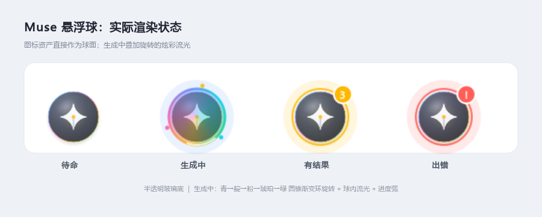
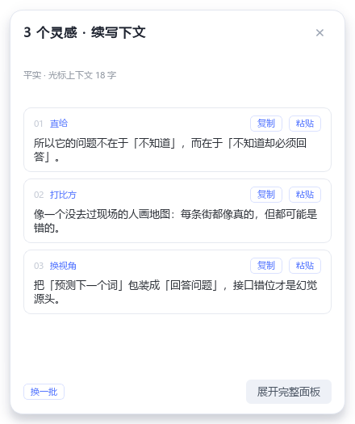
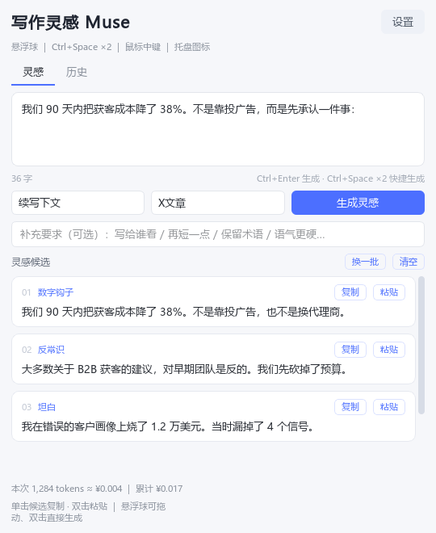
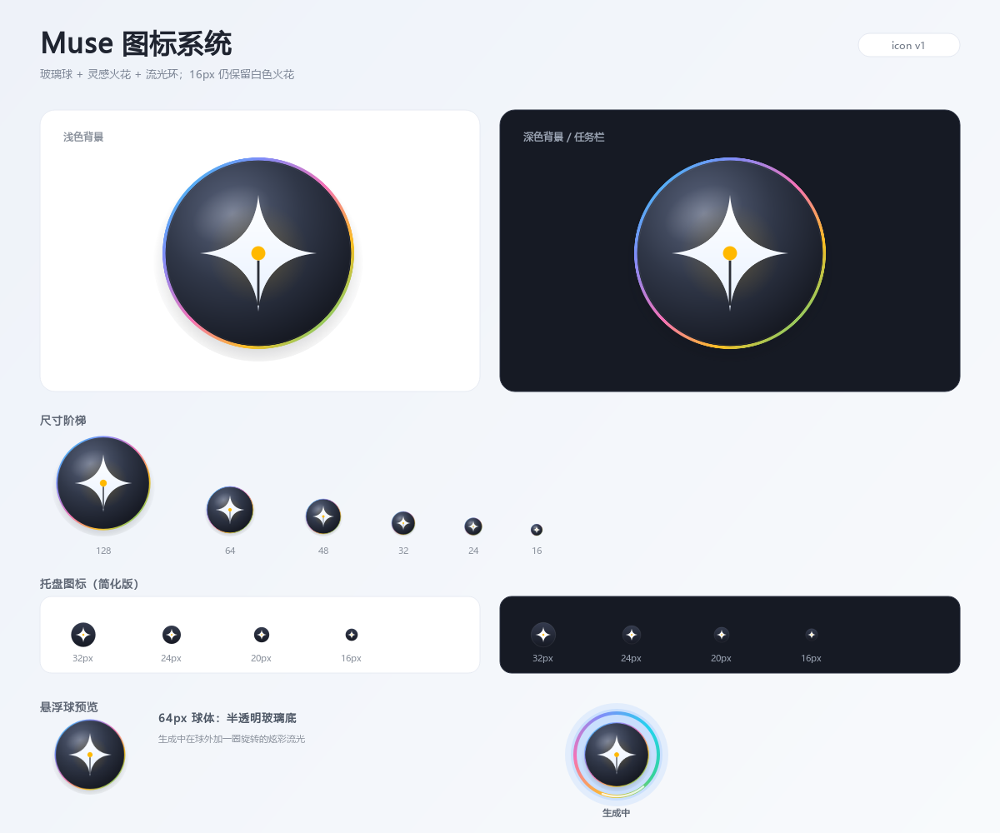

# 写作灵感 Muse

写技术文章时的桌面灵感助手。Muse 是一颗半透明悬浮球：在编辑器里写完一句，**连按两下 `Ctrl+Space`**，它立刻读走光标前的文字开始生成；几秒后，光标旁弹出 3 个可以直接用的候选。





完整面板（也可以从悬浮球单击打开）：



---

## 这一版做了什么

- **悬浮球主入口**：半透明玻璃球，可拖动、吸附屏幕边缘、位置记忆；单击开/收完整面板，双击立即生成，右键菜单，滚轮切换模式。
- **生成时炫彩流光**：青 → 靛 → 粉 → 琥珀 → 绿的圆锥渐变环旋转，球内流光、外圈辉光、进度弧；只在生成中跑 30fps。
- **B 方案快捷键**：`Ctrl+Space` 连按两下触发；单按照常交给输入法/编辑器，不拦截、不延迟。
- **立即请求**：不感知、不轮询、不自动生成。按下第二下快捷键就取上下文、立刻发请求。
- **光标旁弹层**：生成完成后在光标附近弹出 3 张候选卡片；不抢焦点，可复制、粘贴、换一批、展开完整面板。
- **光标上下文**：标准 Edit/RichEdit 控件（记事本、写字板）直接读中文；选区优先；其他编辑器退回键盘缓冲区。
- **完整面板**：输入框、6 种模式、6 种文风、补充要求、文风样本、历史记录、设置。
- **粘贴安全**：写回前校验原窗口；焦点变了只复制，不乱粘贴。
- **新图标**：玻璃球 + 四角火花 + 笔尖/墨点；托盘有 16px 简化版。
- **无感知流程**：旧“自动引导/停顿自动生成”已下线，不会在后台读你的输入。

## 图标



- 矢量源：[assets/muse-icon.svg](assets/muse-icon.svg)
- Windows 图标：[assets/muse-icon.ico](assets/muse-icon.ico)
- 托盘简化版：[assets/muse-tray.svg](assets/muse-tray.svg)
- 多尺寸 PNG 在 `assets/` 下；`main.py` 的 `make_icon()` 会按尺寸自动加载。

图标含义：半透明玻璃球 = 悬浮球；四角火花 = 灵感；下半部收成笔尖、中心琥珀墨点 = 写作；细彩环 = 生成时的流光。

---

## 安装

要求：Windows 10/11 + Python 3.10+。

```powershell
cd D:\A-TC-AI\writing-muse
pip install -r requirements.txt
```

依赖：`PySide6`、`openai`、`pynput`、`httpx`。

## 配置 DeepSeek API Key

任选一种：

1. 启动后点悬浮球 → 打开面板 → **设置** → 填 API Key；
2. 设置环境变量 `DEEPSEEK_API_KEY`（推荐，适合不想把 Key 落盘的人）；
3. 直接编辑 `config.json` 的 `api_key`。

Key 在 https://platform.deepseek.com 创建。充 10 元能用很久。

设置里的「模型」下拉可以直接输入模型名；「测试连接」会调用免费的 `/models` 接口，列出当前账号可用的模型。

> `config.json` 里保存的是明文 Key。不要把整个文件夹发给别人；如果曾经外发过，去后台删掉旧 Key 重新生成。`.gitignore` 已忽略 `config.json` 和 `history.json`。

## 启动

```powershell
python main.py
```

或者双击 `run.vbs`，用 `pythonw` 无控制台启动（前提是 `pythonw.exe` 在 PATH 里）。

启动后**只出现悬浮球**和托盘图标，不弹主窗口。悬浮球默认在主屏右侧垂直居中，可拖到任意位置，松手吸附最近边缘。

开机自启：按 `Win+R` 输入 `shell:startup`，把 `run.vbs` 的快捷方式放进去。

---

## 怎么用

### 悬浮球

| 操作 | 效果 |
|------|------|
| 单击球 | 打开/收起完整面板 |
| 双击球 | 立即用光标上下文生成（等价于快捷键） |
| 拖动球 | 移动；松手吸附屏幕边缘，位置记住 |
| 右键球 | 打开面板 / 立即生成 / 切换模式 / 设置 / 隐藏球 / 退出 |
| 滚轮在球上 | 切换本次模式（续写/润色/标题/提纲/挑刺），气泡提示 |
| 悬停球 | 显示状态气泡 |

球体状态：

- **待命**：半透明玻璃球，缓慢呼吸。
- **生成中**：炫彩流光环 + 球内流光 + 绕行光点。
- **有结果**：琥珀色环 + 数字角标。
- **出错**：红色环 + `!` 角标，点击可重试。

### 快捷键 `Ctrl+Space` ×2

- 按住 Ctrl，连按两下空格，间隔 ≤ `450ms`。
- 单按 `Ctrl+Space` 照常切输入法 / 触发编辑器建议，**Muse 不动作**。
- 连按两下：两下都放行给系统，第二下按下时触发 Muse。
- 生成中再按：只提示“正在生成中”，不并发请求。

> B 方案的代价：中文输入法会连切两次（净状态不变但会闪一下）；VS Code 等把 `Ctrl+Space` 绑成“触发建议”的编辑器可能弹两次建议。如果觉得干扰，设置里可以改成 `Ctrl+Alt+Space`。

### 生成完成后

- 弹层出现在光标附近；拿不到光标位置就锚定球。
- **单击卡片**：复制到剪贴板。
- **双击卡片 / 点「粘贴」**：粘贴回触发时的编辑窗口；焦点变了只复制。
- **换一批**：同一段上下文重新生成。
- **展开完整面板**：带着上下文和候选打开主面板。
- **× / 点击外部**：关闭弹层，候选留在球角标里。

### 完整面板

- `Ctrl+Enter` 生成；`Esc` 隐藏。
- 6 种模式、6 种文风、补充要求、文风样本、历史记录都在这里。
- 设置窗口置顶，不会再被悬浮球挡住。

### 6 种模式

| 模式 | 什么时候用 | 输出 |
|------|-----------|------|
| 续写下文 | 写到一半卡住 | 顺着最后一句往下写，40~140 字 |
| 换词润色 | 句子读着别扭 | 与原文等长的完整替换版本 |
| 灵感发散 | 只有一个主题 | 3 个不同角度的开头 |
| 起标题 | 文章写完了 | 3 个不超过 20 字的标题 |
| 列提纲 | 想法很乱 | 3 种不同的文章结构 |
| 挑刺审稿 | 想找人挑毛病 | 逻辑 / 证据 / 表达各一条具体修改意见 |

快捷键触发的模式：标准编辑控件里有选区 → 润色；无选区且句末是标点 → 润色；否则续写。球上滚轮可临时覆盖。

### 6 种文风

`X文章`（默认）、`平实`、`生动`、`技术严谨`、`去AI腔`、`公众号口语`。

`X文章` 是专门为 X/Twitter 写的文风，规则已经内置，完整提示词见
[prompts/x-article-style.md](prompts/x-article-style.md)。要点：

- 前 2~3 行必须是钩子：具体成果/数字、反常识观点、犯错坦白、紧迫窗口期；
- 段落 1~3 句，段间空行，用纯文本制造节奏；
- 第一行不放外链，不用“🧵 Thread on…”开场；
- 不写 AI 清单体，至少一句“只有作者能说”的判断；
- 结尾引导回复/书签/转发，不写“点赞转发”；
- 技术内容可加简短 ASCII 图，增加收藏价值。

文风只影响语气与结构，不改变任务。更细的控制用输入框下面的**补充要求**：写给产品经理看 / 再短一点 / 保留术语 / 语气更硬。

### 我的文风样本

设置 →「我的文风」粘贴 3~5 句自己过去的文字（最多 1200 字）。每次生成作为语感参考，不照抄。样本也会随请求发送到 DeepSeek，敏感内容不要放。

### 历史记录

生成成功后保存到本机 `history.json`（最近 50 条）。「历史」页双击可载入当时的原文和候选，不用重新花钱生成。设置 →「触发」里可以关闭。

---

## 取词与边界

快捷键触发时，按以下顺序取上下文：

1. **标准 Edit / RichEdit 控件的选区**（记事本、写字板等）——中文可用；
2. **光标前的文字**（同一类控件，最多 3000 字）；
3. **键盘缓冲区**（VS Code / 浏览器等 Electron 控件兜底，只对英文/代码有效）。

没有读到文字时，球会晃一下并提示，**不发请求**。

已知边界：

- **VS Code / Typora / 浏览器**：Electron 渲染控件读不到中文输入法上屏的汉字，快捷键拿不到上下文。中文请用鼠标拖选后**点灵感浮球/按中键**（走剪贴板选区），或把文字粘进完整面板；快捷键本身只对英文/代码缓冲区有效。
- **终端**：不自动发送 `Ctrl+C` 取词，避免打断命令；需要时手动复制后用托盘「从剪贴板生成」。
- **管理员权限窗口**：普通权限的全局钩子收不到它的按键/文本。
- **终端/游戏等全屏窗口**：悬浮球可能仍置顶，可右键隐藏。

## 取词与粘贴的安全设计

- 划词/中键取词会先保存原剪贴板（含图片/文件格式），复制完成后恢复。
- 双击候选写回前，会检查前台窗口是否还是触发时的窗口；焦点变了只复制、不粘贴。
- 自动粘贴后不恢复剪贴板，方便继续使用候选。

## 费用与隐私

- 按 DeepSeek 官方价估算，每次生成约 ¥0.001–0.01；窗口底部实时显示本次和累计费用。单价在 `config.json` 的 `prices_cny_per_1m` 里改。
- 原文、补充要求、文风样本会发送到 DeepSeek API。卡壳片段通常不敏感；不要把整篇未发布文章或密钥贴进去。
- API Key 默认明文保存在本机 `config.json`；也可以改用环境变量。
- 历史记录只在本机，不上传；可在设置里关闭。
- **不做后台感知**：只有你按快捷键/双击球时才读取上下文。

---

## 项目结构

```
writing-muse/
├── main.py              # 悬浮球、灵感弹层、面板、托盘、全局输入、设置
├── muse_core.py         # 提示词、DeepSeek 调用、候选解析、错误翻译
├── config.py            # 配置默认值/合并/原子写入、历史读写
├── test_api.py          # 命令行冒烟测试（会真实调用 API）
├── tests/               # 单元测试 + 本地假 API 集成测试
├── docs/                # 界面截图、悬浮球设计、图标预览
├── assets/              # 图标 SVG/ICO/多尺寸 PNG
├── prompts/             # 文风提示词（X 文章等）
├── config.json          # 本机配置（含 Key，已 gitignore）
├── history.json         # 本机生成历史（已 gitignore）
├── requirements.txt
├── pytest.ini
├── run.vbs              # 无控制台启动
└── README.md
```

## 测试

```powershell
python -m pytest -q
```

测试不会消耗真实额度：`tests/test_generate_integration.py` 会在本机启动一个假 OpenAI 服务，验证请求和解析全链路。快捷键序列、配置读写、候选解析、IME 按键也有单测。

命令行真实连通性测试：

```powershell
python test_api.py
python test_api.py --mode 起标题 --style 去AI腔 --context "为什么 RAG 正在过时"
```

## 常见问题

**快捷键没反应？**
- 默认是 `Ctrl+Space` 连按两下，间隔要在 450ms 内；单按不会触发 Muse。
- 中文输入法会连切两次，属正常现象；觉得干扰可在设置里改成 `Ctrl+Alt+Space`。
- 目标窗口以管理员权限运行：普通权限的键盘钩子收不到，需要同样以管理员权限启动 Muse。
- 设置里确认「启用全局快捷键」是勾上的。

**双击球没生成？**
- 双击球会读取光标上下文；如果前台不是文本编辑器或没读到文字，球会晃一下并提示。
- VS Code/浏览器中文输入法下读不到上屏文字，快捷键/双击球都无法取到；请拖选后点灵感浮球或中键，或把文字粘进完整面板。

**弹层没出现？**
- 生成完成后才会弹；生成中只有球体流光。
- 看球是否变成“有结果”角标；有结果但弹层被关掉，单击球可再看。

**双击候选没粘贴？**
- 焦点已经离开原编辑器时，Muse 只复制不粘贴，托盘会提示。手动 `Ctrl+V` 即可。
- 某些管理员权限窗口会拒绝普通权限程序的模拟按键。

**报 401 / 402 / 429？**
- 401：Key 无效或过期；402：余额不足；429：限流，等几秒再试。错误会显示在弹层/面板底部。
