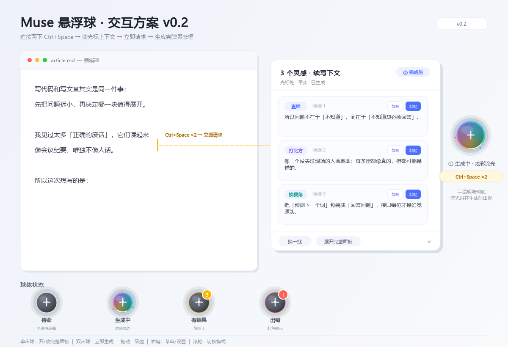
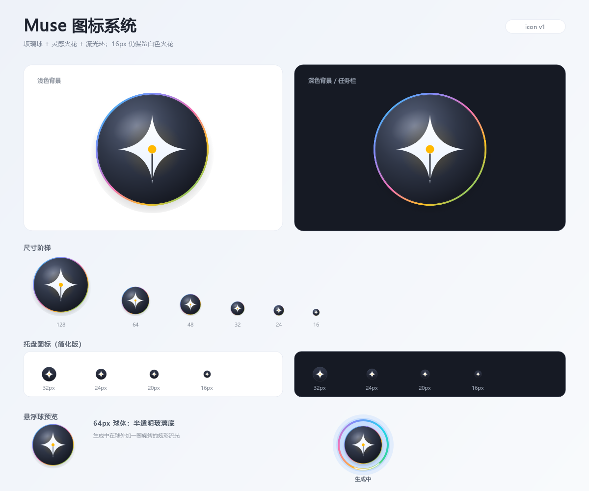

# Muse 悬浮球交互方案 v0.2



> 状态：P0 已落地（2026-11）。悬浮球、B 方案快捷键、光标上下文、快速请求、灵感弹层已接入。示意图是设计稿，实际渲染见 `docs/ball-states-live.png` 与 `docs/quick-popup-live.png`。

> 按你的选择重做：**快捷键 B（单按放行、连按触发）**、**不做感知**、**半透明球体 + 生成时炫彩流光**。

---

## 0. 已确认的决策

| 项 | 决定 |
|----|------|
| 快捷键 | `Ctrl+Space` 连按两下触发；单按照常交给输入法/编辑器 |
| 感知 | **不做**。不轮询、不自动运行、不显示“感知中/就绪” |
| 触发后的动作 | 立刻采集光标上下文 → 立刻发请求 → 生成完成后弹灵感框 |
| 球体外观 | 半透明底色；生成中球体出现炫彩流光 |
| 结果呈现 | 光标旁灵感弹层（3 个候选），可展开完整面板 |

---

## 1. 一句话体验

Muse 是一颗半透明的写作球。写完一句停一下，**连按两下 `Ctrl+Space`**，它立刻读走光标前的文字开始生成；几秒后，光标旁弹出 3 个可以直接用的候选。

---

## 2. 三个形态

### 2.1 悬浮球（主入口）

- 直径 64px，可拖动，松手吸附到最近屏幕边缘，位置记忆。
- **半透明深色玻璃底**：中心到边缘 `rgba(58,64,80,0.75)` → `rgba(24,27,35,0.67)`，1px 浅色描边，左上角高光，底部柔和投影。
- 球心是一个白色小火花图标；外圈是状态环。
- 悬停：球放大到 1.06 倍，描边变亮，400ms 后显示气泡：
  `Muse · 双击生成 · Ctrl+Space ×2`
- 右键：菜单；拖动：吸边；滚轮：切换本次生成模式。
- 默认停在主屏右侧、垂直居中。

### 2.2 灵感弹层（生成结果）

- 约 420×460，白色圆角卡片，锚定在**光标附近**；拿不到光标就锚定球。
- 标题：`3 个灵感 · 续写 · 平实`。
- 3 张候选卡片：角度标签 + 正文 + `复制` / `粘贴`。
- 底部：`换一批` · `展开完整面板` · `停止`。
- 不抢焦点：弹层出现时输入法、光标仍留在编辑器里；点卡片复制，双击粘贴回原文。
- 点击弹层外部或右上角 `×` 关闭；结果保留在球上，球显示角标 `3`。
- 生成失败时同一位置显示错误信息和 `重试`。

### 2.3 完整面板（备用）

- 现有 `MuseWindow` 保留：输入框、模式、候选、历史、设置。
- 单击球展开/收起；面板关闭后回到球。
- 弹层里的「展开完整面板」把当前上下文和候选带进面板，方便继续改。

---

## 3. 状态机（只保留 4 个状态）

```
待命 ──触发──> 生成中 ──成功──> 有结果 ──查看/关闭──> 待命
                    └──失败──> 出错 ──重试/关闭──> 待命
```

| 状态 | 球体 | 文案 |
|------|------|------|
| 待命 | 半透明玻璃球，缓慢呼吸 | `双击生成 · Ctrl+Space ×2` |
| 生成中 | 炫彩流光环 + 内部流光 + 进度弧 | `正在想…` |
| 有结果 | 琥珀色环 + 数字角标 | `3 个候选` |
| 出错 | 红色环 + `!` 角标 | 悬停显示错误 |

没有“感知中”“就绪”“自动运行”状态。

---

## 4. 快捷键：B 方案

### 4.1 键位语义

**按住 Ctrl，连按两下空格。** 两下 `Ctrl+Space` 的间隔 ≤ `450ms` 才触发。

### 4.2 行为规则

| 操作 | 系统/编辑器收到什么 | Muse |
|------|--------------------|------|
| 单按 `Ctrl+Space` | 正常收到（切输入法 / 触发建议） | 不动作 |
| 450ms 内连按两下 | **两下都正常收到** | 第二下按下时触发采集+生成 |
| 超过 450ms 再按 | 视为新的一次单按 | 不动作 |

**关键：不拦截、不延迟、不补发。** 这是 B 方案和 A 方案最大的区别：单按零延迟，代价是两次 `Ctrl+Space` 都会被应用收到。

### 4.3 副作用（明确接受）

- 中文输入法会切换两次，净状态回到原样；输入法指示器可能闪一下。
- VS Code 等把 `Ctrl+Space` 绑定为“触发建议”的编辑器，可能弹两次建议。
- 如果某个应用把 `Ctrl+Space` 绑成危险操作，连按会执行两次。

> 如果实际用起来觉得闪得难受，设置里可以改成 `Ctrl+Alt+Space`，逻辑不变，只是不碰输入法。

### 4.4 检测方式

- 在全局键盘钩子里维护一个**序列匹配器**：
  - 第一次匹配 `Ctrl+Space` → 记录时间，进入等待；
  - 450ms 内第二次匹配 → 触发 `hotkey` 信号；
  - 超时或按了别的键 → 重置。
- 只观察，不调用 `suppress_event()`。
- 松开 Ctrl 后再按 Space 不算；必须是两次 `Ctrl+Space`。
- 序列和判定窗口可在设置里改（`ctrl+space,ctrl+space`、`450ms`）。

---

## 5. 触发后：立刻采集上下文

不轮询、不缓存、不感知。按下第二下 `Ctrl+Space` 的那一刻，同步做三件事：

```
① 记录前台窗口 hwnd（用于之后粘贴）
② 读取光标上下文（优先级如下）
   选区文字
   > 光标前最近 3000 字（标准 Edit/RichEdit 控件）
   > 最近键盘缓冲区（Electron/浏览器兜底，中文可能为空）
③ 记录光标屏幕坐标（用于弹层定位；取不到就用球的位置）
```

### 5.1 光标判断

- 标准 `Edit` / `RichEdit`：`GetGUIThreadInfo().hwndCaret != 0` 或焦点控件类名含 `Edit` → 有光标。
- Electron/浏览器：拿不到 `hwndCaret` 时，只要前台窗口标题是受支持编辑器、且最近有输入，就尝试读键盘缓冲区。
- 完全没有上下文：球体左右轻晃一下，气泡提示 `没读到光标前的文字，先点一下输入框`，**不发请求**。

### 5.2 模式选择

- 有选区 → `换词润色`
- 无选区、末尾是句号/问号/感叹号 → `换词润色`
- 否则 → `续写下文`
- 球上滚轮可临时改成：起标题 / 列提纲 / 挑刺审稿。

---

## 6. 请求与结果

### 6.1 立刻请求

- 采集完成后**不等待、不防抖**，直接启动后台线程调用 API。
- 球立即进入「生成中」，开始炫彩流光；弹层不提前出现。
- 请求期间再按快捷键：忽略（或提示“正在生成”），不并发烧钱。
- 支持停止：右键球/弹层里的 `停止` 会丢弃这次结果。

### 6.2 生成完成

**成功：**
1. 球切到「有结果」，显示角标 `3`，脉冲一次。
2. 弹层出现在光标旁，展示 3 张卡片。
3. 同时把结果写入完整面板与历史（展开面板时直接可看）。

**失败：**
1. 球切到「出错」，红色环 + `!`。
2. 弹层显示错误原因 + `重试`。
3. 不写入历史，但照常记录 token 费用（如果有）。

### 6.3 弹层里的动作

| 动作 | 结果 |
|------|------|
| 单击卡片 | 复制候选到剪贴板，弹层底部提示“已复制” |
| 双击卡片 / 点「粘贴」 | 粘贴回触发时的原窗口；焦点变了就只复制 |
| 换一批 | 用同一段上下文重新请求，弹层先收起，球重新流光 |
| 展开完整面板 | 带上下文和候选打开 `MuseWindow` |
| 停止 | 丢弃当前请求，球回到待命 |
| `×` / 点外部 | 关闭弹层，候选留在球角标里 |

---

## 7. 球体视觉

### 7.1 待命

- 半透明深色玻璃底，64px。
- 中心白色火花图标，外圈 1px 浅色描边。
- 呼吸：缩放 1.0 → 1.03，周期 3s；透明度 0.82 → 0.9。
- 悬停：缩放 1.06，描边 60% 白，显示气泡。

### 7.2 生成中（炫彩流光）

这是重点效果：

- **外环**：3px 圆锥渐变环，颜色依次为
  `#22D3EE 青 → #818CF8 靛 → #F472B6 粉 → #FBBF24 琥珀 → #34D399 绿 → 回到青`
- **旋转**：整圈 1.2s 转一圈；同时环的亮度轻微呼吸。
- **球内**：同一组圆锥渐变以 18%~25% 透明度铺满球体，随角度旋转；叠加一块移动的柔光高光。
- **粒子**：2~3 个 2px 的小光点沿环外侧缓慢绕行。
- **光晕**：球外 10px 的彩色辉光，色相跟随环的当前主色变化。
- **进度弧**：环上叠一段 60° 的白色高亮弧，表示“正在想”。
- **帧率**：生成中 30fps；待命 10fps；只在生成中做渐变计算，避免常驻占 CPU。

### 7.3 有结果 / 出错

- 有结果：环变琥珀色，右上角红色角标 `3`；完成瞬间一次 200ms 放大脉冲。
- 出错：环变红色，角标 `!`；球体轻晃一次。

### 7.4 图标



悬浮球和程序图标共用一套标记：

- **玻璃球底**：半透明深色球体，对应悬浮球的玻璃质感。
- **四角火花**：表示灵感、生成；四条边内凹，远看仍然是一个清楚的火花。
- **笔尖缝 + 琥珀墨点**：火花的下半部分收成笔尖，中间一条细缝，中心一颗琥珀色墨点——把“灵感”和“写作”合在一起。
- **流光环**：青 → 靛 → 粉 → 琥珀 → 绿的细环，对应生成时的炫彩流光。

派生文件：

- `assets/muse-icon.svg`：完整图标矢量源；
- `assets/muse-tray.svg`：16~32px 托盘简化版（去掉流光环，加大火花）；
- `assets/muse-icon.ico`：Windows 多尺寸图标；
- `assets/muse-icon-*.png`、`assets/muse-tray-*.png`：16 / 20 / 24 / 32 / 48 / 64 / 96 / 128 / 256 / 512 / 1024 导出。

**小尺寸策略**：16~32px 使用简化版，只保留深色圆底 + 白色火花 + 琥珀点；48px 以上使用完整玻璃球和流光环。这样任务栏/托盘在浅色和深色背景上都能认出来。

---

## 8. 手势

| 手势 | 行为 |
|------|------|
| 单击球 | 打开/收起完整面板 |
| 双击球 | 立即用光标上下文生成（与快捷键等价） |
| 拖动球 | 移动，松手吸附最近边缘 |
| 右键球 | 菜单：打开面板 / 立即生成 / 切换模式 / 设置 / 隐藏球 / 退出 |
| 滚轮 | 切换本次模式（续写/润色/标题/提纲/挑刺），气泡显示当前模式 |
| 悬停 | 400ms 显示状态气泡 |
| `Esc` | 关闭弹层/面板 |
| `Ctrl+Space ×2` | 采集光标上下文并立即生成 |

---

## 9. 设置项

快捷键页：

```jsonc
"hotkey": {
  "enabled": true,
  "sequence": "ctrl+space,ctrl+space",
  "judge_ms": 450
}
```

悬浮球页：

```jsonc
"ball": {
  "enabled": true,
  "x": null,
  "y": null,
  "size": 64,
  "opacity": 0.82
}
```

**删除/隐藏**：自动引导、感知轮询、就绪提示、自动运行相关设置全部下线（配置里保留旧键做兼容，但不再生效）。

---

## 10. 边界

- **输入法**：B 方案会让 IME 连切两次，净状态不变；单按零延迟。
- **VS Code**：`Ctrl+Space` 建议可能弹两次；如果无法接受，改 `Ctrl+Alt+Space`。
- **Electron 中文**：VS Code/Typora/浏览器读不到上屏汉字，快捷键会提示“没读到光标前的文字”；中文请用鼠标拖选后按鼠标中键（走剪贴板选区），或把文字粘进完整面板。
- **管理员窗口**：普通权限钩子收不到 elevated 窗口的按键/文本。
- **无光标**：球晃一下，不发请求。
- **多屏/DPI**：球位置按屏幕保存；弹层 clamp 到当前屏幕。
- **弹层焦点**：弹层不抢焦点，所以 `Esc` 走全局钩子；关闭按钮始终可点。

---

## 11. 技术落点

| 模块 | 做法 |
|------|------|
| `BallWindow` | 无边框半透明置顶窗口；`paintEvent` 画玻璃球；`QTimer` 驱动呼吸/流光；拖动+吸边 |
| `ResultPopup` | 420×460 弹层；复用 `CandidateCard`；`WA_ShowWithoutActivating` |
| `HotkeySequence` | 纯状态机，喂 `(mods, vk, now)`，返回是否触发；可单测 |
| `read_edit_context` | `WM_GETTEXT + EM_GETSEL`；选区优先，否则光标前 3000 字 |
| `get_caret_screen_pos` | `GUITHREADINFO.rcCaret` + `ClientToScreen` |
| `MuseWindow.trigger_quick` | 采集 → 记录目标 hwnd → 立即 `_run_generate(quick=True)` |
| 配置 | 新增 `ball` 段、`hotkey.sequence/judge_ms`；自动引导失效 |
| 清理 | 移除感知轮询/就绪/自动运行 UI 与定时器 |

---

## 12. 实施顺序

**P0（这一版就做）**
1. `HotkeySequence` + B 方案接入。
2. 半透明 `BallWindow` + 待命呼吸 + 生成流光 + 吸边。
3. 光标上下文读取 + 目标 hwnd + 光标坐标。
4. `trigger_quick` → 立刻请求 → `ResultPopup`。
5. 单击球/双击球/右键菜单。

**P1（打磨）**
- 弹层锚定光标、错误重试、换一批、展开面板。
- 球体状态角标、悬停气泡、滚轮切模式。
- 设置页快捷键/球体参数。
- 移除旧感知 UI。

**P2（可选）**
- 球体透明度/尺寸调节、全屏隐藏、多屏位置记忆。
- 流光配色主题。

---

## 13. 这版设计里我替你定的默认值

- 单击球 = 打开/收起完整面板；双击球 = 立即生成。
- 球默认在主屏右侧垂直居中，半透明度 0.82。
- 快捷键判定窗口 450ms。
- 有选区 → 润色；无选区且句子完整 → 润色；否则续写。
- 生成中再按快捷键 = 忽略，不并发。

如果这些默认值没问题，我就按 P0 开始改代码。
